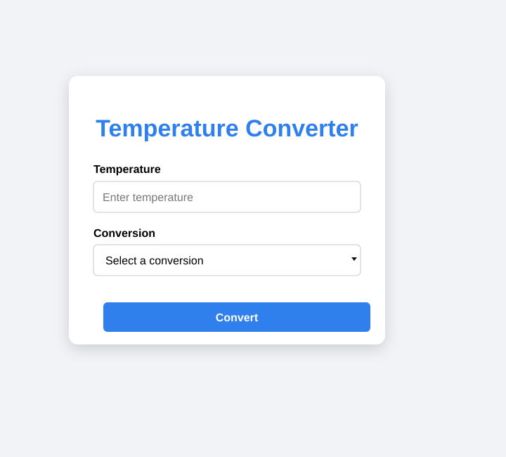
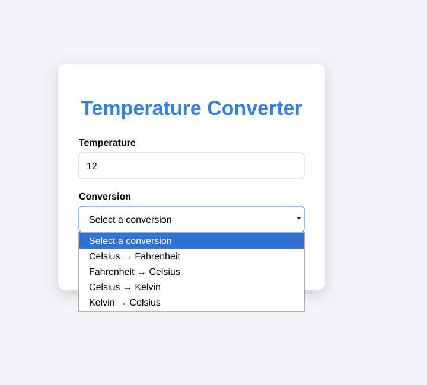
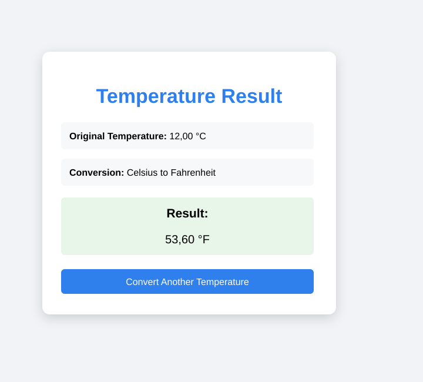
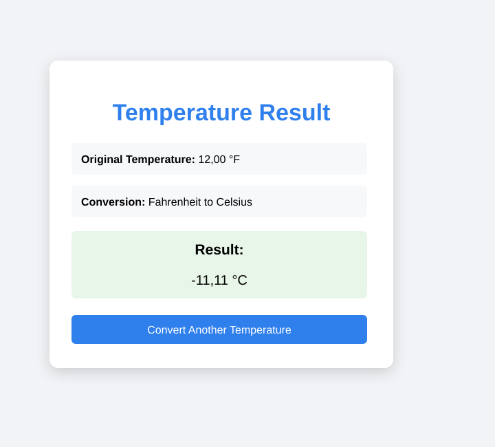

# Temperature Converter Servlet

**Universidad Castro Carazo**  
**Proyecto:** Conversor Web de Temperaturas con Servlets en Java

## Índice

1. [Repositorio GitHub](#repositorio-github)
2. [Objetivo del proyecto](#objetivo-del-proyecto)
3. [Explicación de la lógica utilizada](#explicación-de-la-lógica-utilizada)
4. [Flujo de funcionamiento](#flujo-de-funcionamiento)
5. [Evidencias](#evidencias)
6. [Revisión de cumplimiento](#revisión-de-cumplimiento)
7. [Referencias APA](#referencias-apa)

## Repositorio GitHub

https://github.com/Andri-Almengor/temperature-converter-servlet

## Objetivo del proyecto

El proyecto desarrolla un conversor web de temperaturas usando un formulario HTML y un Servlet de Java. La aplicación permite ingresar una temperatura, seleccionar el tipo de conversión y obtener el resultado en una página de respuesta.

Las conversiones disponibles son:

- Celsius a Fahrenheit.
- Fahrenheit a Celsius.
- Celsius a Kelvin.
- Kelvin a Celsius.

## Explicación de la lógica utilizada

La solución se organiza en tres responsabilidades principales: la interfaz, el procesamiento de la solicitud y el cálculo de la temperatura.

Primero, la persona usuaria escribe una temperatura y selecciona una conversión en el formulario. El formulario evita que se envíen campos vacíos y permite ingresar valores con decimales.

Cuando se presiona **Convert**, la información se envía al servidor mediante una solicitud **POST**. El Servlet recibe la temperatura y el tipo de conversión seleccionado. Después verifica que la temperatura pueda interpretarse como un número.

El cálculo no se mezcla con la presentación. Para realizar la operación, el Servlet utiliza una clase separada encargada únicamente de las conversiones. Esta clase identifica qué conversión fue elegida, aplica la fórmula correspondiente y devuelve el resultado.

Una vez obtenido el valor convertido, el Servlet determina las unidades de entrada y salida, prepara una descripción legible de la conversión y presenta el resultado con dos decimales. Finalmente genera una página clara con la temperatura original, el tipo de conversión y el valor final.

La página de resultados incluye la opción **Convert Another Temperature**, que devuelve a la pantalla inicial para realizar una nueva operación. Además, si el valor recibido no puede convertirse a número, la aplicación muestra un mensaje de error en lugar de continuar con un cálculo inválido.

## Flujo de funcionamiento

1. Se abre la pantalla principal del conversor.
2. Se ingresa una temperatura.
3. Se selecciona una de las cuatro conversiones disponibles.
4. El formulario envía los datos al Servlet mediante POST.
5. El Servlet obtiene y valida los datos recibidos.
6. La clase de conversión aplica la fórmula seleccionada.
7. El Servlet asigna las unidades correctas y formatea el resultado.
8. Se muestra una página con el resultado obtenido.
9. La persona usuaria puede regresar al formulario y realizar otra conversión.

## Evidencias

Las siguientes evidencias muestran la interfaz funcionando, las opciones disponibles y los resultados obtenidos en las cuatro conversiones.

### Figura 1. Pantalla inicial del conversor

**Fuente:** Elaboración propia a partir de la ejecución local del proyecto.

### Figura 2. Opciones de conversión disponibles

**Fuente:** Elaboración propia a partir de la ejecución local del proyecto.

### Figura 3. Conversión de Celsius a Fahrenheit

Resultado comprobado con 12 °C: **53,60 °F**.

**Fuente:** Elaboración propia a partir de la ejecución local del proyecto.

### Figura 4. Conversión de Fahrenheit a Celsius

Resultado comprobado con 12 °F: **-11,11 °C**.

**Fuente:** Elaboración propia a partir de la ejecución local del proyecto.

### Figura 5. Conversión de Celsius a Kelvin

Resultado comprobado con 12 °C: **285,15 K**.

**Fuente:** Elaboración propia a partir de la ejecución local del proyecto.

### Figura 6. Conversión de Kelvin a Celsius

Resultado comprobado con 12 K: **-261,15 °C**.

**Fuente:** Elaboración propia a partir de la ejecución local del proyecto.

## Revisión de cumplimiento

De acuerdo con la estructura actual del repositorio y las evidencias proporcionadas, el proyecto incluye:

- ✅ Formulario web para ingresar la temperatura.
- ✅ Selector con cuatro tipos de conversión.
- ✅ Envío de información mediante POST.
- ✅ Servlet para recibir y procesar la solicitud.
- ✅ Clase independiente para realizar los cálculos.
- ✅ Conversión Celsius → Fahrenheit.
- ✅ Conversión Fahrenheit → Celsius.
- ✅ Conversión Celsius → Kelvin.
- ✅ Conversión Kelvin → Celsius.
- ✅ Presentación del valor original, conversión realizada y resultado.
- ✅ Resultado limitado visualmente a dos decimales.
- ✅ Validación básica de entrada y manejo de valores no numéricos.
- ✅ Evidencias de la ejecución y de los resultados.

> **Observación:** actualmente el Servlet implementa el procesamiento mediante `doPost`. Si la rúbrica exige explícitamente implementar también `doGet`, ese sería el único punto que conviene agregar antes de la entrega.

## Referencias APA

Eclipse Foundation. (2022). *Jakarta Servlet Specification, Version 6.0*. https://jakarta.ee/specifications/servlet/6.0/jakarta-servlet-spec-6.0

MDN Web Docs. (2025). *<form>: The Form element*. https://developer.mozilla.org/en-US/docs/Web/HTML/Reference/Elements/form

Oracle. (2026). *DecimalFormat (Java SE 26 & JDK 26)*. https://docs.oracle.com/en/java/javase/26/docs/api/java.base/java/text/DecimalFormat.html
